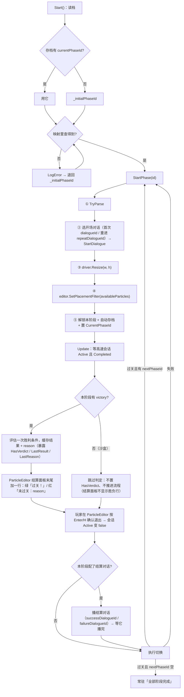
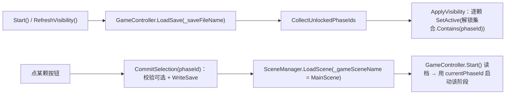

# 游戏流程（GameFlow）

> 适用：Unity 2022.3.62f1 / URP 2D 落沙模拟
> 位置：`Assets/Scripts/Driver/Game*.cs`、`VictoryEvaluator.cs`（程序集 `TapTap2026.Game`）；示例阶段文件 `Assets/Data/Phases/`
> 与粒子模拟（`docs/ParticleTypeInterface.md`）、对话系统（`docs/DialogueSystem.md`）**分层**：本层只负责「阶段顺序 + 胜利判定 + 存档」，不碰模拟内核，也不做对话 UI。

---

## 1. 组成

| 文件 | 角色 |
|---|---|
| `GamePhaseData.cs` | **纯 C#**：阶段 JSON 数据类（`GamePhaseData` / `VictoryCondition` / `ParticleCountCondition`）+ `GamePhaseParser.TryParse`（`JsonUtility`，免第三方依赖）+ 两个纯解析方法 `ResolveOpeningDialogueId(isRepeat)` / `ResolveResultDialogueId(passed)` |
| `VictoryEvaluator.cs` | **纯 C# 判定**：`HighSpeedSnapshot` + `VictoryEvaluator.Evaluate`，只用快照与配置算胜负（无 Input / UI / 协程，可 EditMode 测试） |
| `GameController.cs` | **流程薄壳**（MonoBehaviour）：阶段映射、`StartPhase` 五步、高速模式轮询、胜负结论缓存（暴露给结算面板读取）、**结算对话（过关 / 未过关各一段，见 §4.4）**、自动存档；同时是**存档格式的唯一权威**（`SaveData` DTO + 静态 `SavePathFor` / `LoadSave` / `CollectUnlockedPhaseIds` / `WriteSave`） |
| `LevelSelectController.cs` | **关卡选择界面控制器**（MonoBehaviour）：按存档解锁集合控制按钮显隐、点选后写档并加载游戏场景（见 §10） |
| `Assets/Data/Phases/phase_01.json` … `phase_05.json` | 阶段数据（`TextAsset`，`TextScriptImporter`）：`phase_01` 入职日 → `phase_02` 第一日 → `phase_03` 第二日 → `phase_04` 第三日 → `phase_05` 沙盒（无 `victory`、无 `nextPhaseId`） |
| `Assets/Tests/EditMode/GameFlowTests.cs` | 解析与胜利判定的 EditMode 测试 |
| `Assets/Tests/EditMode/GameSaveProgressTests.cs` | 静态存档 API 的 EditMode 测试 |
| `Assets/Tests/EditMode/LevelSelectControllerTests.cs` | 关卡选择控制器逻辑的 EditMode 测试 |
| `Assets/Tests/EditMode/LevelSelectSceneWiringTests.cs` | `LevelSelect.unity` 场景接线的 EditMode 回归测试 |

依赖方向：`GameController` →（`GamePhaseParser` / `VictoryEvaluator`）→ `ParticleRegistry`、`ParticleSimulationDriver`、`ParticleEditor`、`DialogueController`。解析与判定本身不反向依赖任何 MonoBehaviour。`ParticleEditor` 另**只读** `GameController` 的结算属性（`HasVerdict` / `LastResult` / `LastReason`）以在结算面板显示胜负行——未接线时只是不显示那一行。`LevelSelectController` **只读**存档（静态 API）→ `SceneManager.LoadScene`，不引用流程层其余部分。

---

## 2. 阶段文件格式（JSON）

一个文件 = **一个阶段**。文件里的字段与 `GamePhaseData` **逐字对应、大小写敏感**（`JsonUtility` 规则）。

```json
{
  "description": "入职日：认识沙盒与投放操作，让沙地上长出第一片草地。",
  "dialogueId": "phase_01_intro",
  "repeatDialogueId": "phase_01_retry",
  "successDialogueId": "phase_01_clear",
  "failureDialogueId": "phase_01_fail",
  "nextPhaseId": "phase_02",
  "sandboxWidth": 160,
  "sandboxHeight": 90,
  "victory": {
    "minSurfaceTemperature": 5.0,
    "maxSurfaceTemperature": 40.0,
    "particles": [
      { "type": "GrassParticle", "minBirths": 10 }
    ]
  }
}
```
（示例是 `phase_01.json` 的开发期形态再加上四个对话字段：它**省略 `availableParticles`**——不限制，全粒子可投；实际文件目前**只配了 `dialogueId` / `repeatDialogueId`**，两个结算对话要等有对话文本后再补（见 §4.4 与 §7.5）。）

| 字段 | 类型 | 说明 |
|---|---|---|
| `id` | string | **不写在 JSON 里**：由 `GameController` 在加载时按**文件名去扩展名**回填（`phase_01.json` → `phase_01`），保证「文件名 = 阶段 id = `nextPhaseId` 的引用目标」 |
| `description` | string | **关卡简要描述**（纯 UI 元数据）：关卡选择界面悬停在该关卡按钮上时显示到 `Canvas/ProbeText`（见 §9）；**省略 / 空 = 无描述**（悬停时该关不显示文本）。流程层（`GameController` / `VictoryEvaluator`）**不读**本字段 |
| `dialogueId` | string | **首次**进入本阶段时播放的对话 id（`DialogueController` **注册表**里的 id，见 §6）；**省略 / 空 = 本阶段无对话** |
| `repeatDialogueId` | string | **重复**进入本阶段（该阶段已在解锁集合里）时播放的对话 id（同样是注册表 id）；**省略 / 空 = 重进不播对话**。二者由 `GamePhaseData.ResolveOpeningDialogueId(isRepeat)` 二选一 |
| `successDialogueId` | string | **结算对话（过关）**：本阶段高速模式结算为**过关**后、进入下一阶段之前播的对话 id（注册表 id）；**省略 / 空 = 不播结算对话**（流程与既有行为逐字一致，见 §4.4） |
| `failureDialogueId` | string | **结算对话（未过关）**：本阶段高速模式结算为**未过关**后、重开本阶段之前播的对话 id；**省略 / 空 = 不播结算对话**。二者由 `GamePhaseData.ResolveResultDialogueId(passed)` 二选一 |
| `nextPhaseId` | string | 过关后进入的下一阶段 id；**省略 / 空 = 最终阶段**（过关后停在「全部阶段完成」） |
| `sandboxWidth` | int | 沙箱宽（格）。**必须 ≥ 1**，否则解析失败 |
| `sandboxHeight` | int | 沙箱高（格）。**必须 ≥ 1**，否则解析失败 |
| `availableParticles` | string[] | 本阶段可手动投放的粒子名单（`DebugName` 或类名，匹配规则同 `ParticleEditor.ResolveTypeNames`）；**省略 / 空 = 不限制**（用编辑器的默认白名单） |
| `victory` | object | 胜利条件，见 §3；**省略 / 全哨兵 / null = 本阶段没有胜利条件**（沙盒阶段：高速模式跑完后不判定、不推进流程，见 §4.3） |

> **`victory` 归一化（2026-10-16 修复）**：`JsonUtility.FromJson` 在本版本（2022.3.62f1）对**省略的嵌套可序列化类**会默认构造一个实例而不是留 null——`victory` 省略时得到的是「全哨兵（什么也不约束）」的 `VictoryCondition`。`GamePhaseParser.TryParse` 因此在 `particles[].type` 校验之后把它**归一为 null**：省略的 / 全哨兵的（四个界限全 `float.NaN` 且 `particles` 为 null 或空）`victory` 一律读出 `null` = 本阶段没有胜利条件。字符串 / 数组字段不受影响（省略仍为 null）。

**解析语义**（`GamePhaseParser.TryParse`，与 `DialogueData.TryParse` 一致）：

- JSON 语法坏 → 返回 `false`，`error` 描述原因，`phase` 为 null。
- **缺省字段保留 C# 字段初始值**（`JsonUtility` 不清空未出现的字段）——因此「省略 = 不约束」是靠哨兵初始值实现的，见 §3.2。
- 额外校验（不通过则 `false` + `error`）：
  - `sandboxWidth < 1` 或 `sandboxHeight < 1`；
  - `victory.particles[]` 里有条目的 `type` 为空 / 空白。
- **额外归一**：全哨兵的 `victory` → `null`（见上）。

---

## 3. 胜利条件（`VictoryCondition`）

### 3.1 结构

```csharp
[Serializable] public sealed class VictoryCondition
{
    public float minSurfaceTemperature;   // 初始值 float.NaN
    public float maxSurfaceTemperature;   // 初始值 float.NaN
    public float minAverageHumidity;      // 初始值 float.NaN
    public float maxAverageHumidity;      // 初始值 float.NaN
    public ParticleCountCondition[] particles;  // 初始值 null
}

[Serializable] public sealed class ParticleCountCondition
{
    public string type;    // DebugName 或类名
    public int minBirths;  // 初始值 -1
    public int maxBirths;  // 初始值 -1
    public int minDeaths;  // 初始值 -1
    public int maxDeaths;  // 初始值 -1
    public int minCount;   // 初始值 -1；对高速结束时的存量判定
    public int maxCount;   // 初始值 -1；对高速结束时的存量判定
}
```

```json
{
  "victory": {
    "minSurfaceTemperature": 10.0,
    "maxSurfaceTemperature": 30.0,
    "minAverageHumidity": 0.35,
    "particles": [ { "type": "GrassParticle", "minBirths": 40 } ]
  }
}
```

### 3.2 哨兵值表（**省略字段 = 不约束**）

| 哨兵 | 含义 |
|---|---|
| `float.NaN`（温度 / 湿度约束的默认值） | 该约束**不启用**；JSON 里**不要写** `NaN` |
| `-1`（计数 / 存量约束 `min*` / `max*` 的默认值） | 该方向**不约束**；`min = 0` 是「至少 0（恒真）」，与「不约束」不同但结果相同 |
| `particles` 为 `null` / 空数组 | 无计数 / 存量约束 |
| `victory` 为 `null`（JSON 里省略 / 全哨兵 / `particles` 为空会被归一为 null） | 本阶段没有胜利条件（沙盒阶段：高速模式跑完后不判定、不推进流程） |

> ⚠️ `JsonUtility` **不支持 `long`**，所以计数字段一律用 `int`（模拟内部计数是 `long`，快照结构里保留 `long`，判定时直接比较，不去截断）。

### 3.3 判定语义（`VictoryEvaluator.Evaluate`）

输入是**高速模式的一次快照** `HighSpeedSnapshot`：

| 字段 | 来源 |
|---|---|
| `surfaceTemperature` | `HighSpeedSession.LatestSurfaceTemperature`（**可能为 `NaN` = 本轮未采样**） |
| `averageHumidity` | `HighSpeedSession.LatestAverageHumidity` |
| `counts[]` | 遍历 `ParticleRegistry.Types`，对**每个已注册类型**（含计数为 0 的）取 `GetBirths` / `GetDeaths` / `GetFinalCount` |

判定规则，按**固定顺序**逐条检查：

1. `condition == null` → `false`，`reason` 说明「本阶段没有胜利条件」。
   （`GameController` 对 `victory == null` 的阶段**不调本判定**也不推进流程，见 §4.3；本条只描述纯函数的输出。）
2. 温度：`minSurfaceTemperature` 启用时要求 `snapshot.surfaceTemperature >= min`；`maxSurfaceTemperature` 启用时要求 `<= max`。**边界含等号**。
   - 快照温度为 `NaN` 且存在任一温度约束 → 判负（既然要求了温度，就要求采样到）。
3. 湿度：`minAverageHumidity` / `maxAverageHumidity` 同理，`>= min` / `<= max`，边界含等号。
4. 计数：对 `particles[]` 里每一条，把 `type` 解析成 typeId（`DebugName` 或类名，同 `ParticleEditor.ResolveTypeNames` 规则），在快照 `counts` 里找该类型；按固定顺序 `minBirths` → `maxBirths` → `minDeaths` → `maxDeaths` → `minCount` → `maxCount` 逐项检查，各自 `-1` 表示不约束，否则 `>= min` / `<= max`（**边界含等号**）。任一不满足即整条失败。
   - `minCount` / `maxCount` 判的是**高速结束那一刻的存量格数**（`HighSpeedSession.GetFinalCount`，会话跑满时的一次全网格盘点），不是产生 / 死亡等流量。
   - 名字查不到 → `false` + `reason` 指出这是**配置错误**（不是玩家没达成）。
5. 全部约束通过 → `true`，`reason` 为通过摘要。
6. **任一不满足 → 立即返回 `false`**，`reason` 是**第一条未满足项**的描述，形如：
   - `地表温度 12.3° 低于要求 20°`
   - `GrassParticle 产生 3 低于要求 10`
   - `GrassParticle 存量 3 低于要求 10` / `GrassParticle 存量 25 高于要求 10`

**测试友好**：`Evaluate` 是纯函数，输入快照、输出布尔 + 理由，不读 `Time.*` / `Input` / 场景对象。

---

## 4. `GameController`（流程薄壳）

### 4.1 Inspector 字段

| 字段 | 类型 | 说明 |
|---|---|---|
| `_driver` | `ParticleSimulationDriver` | 沙箱驱动（`Resize` / `HighSpeed` 会话来源） |
| `_editor` | `ParticleEditor` | 投放白名单与自动选型 |
| `_dialogue` | `DialogueController` | 阶段对话播放 |
| `_phases` | `TextAsset[]` | 全部阶段 JSON；加载时按**文件名**建 `id → TextAsset` 映射（解析失败 `LogError` 并跳过该条目） |
| `_initialPhaseId` | string | 无存档时的起始阶段 id |
| `_saveFileName` | string | 存档文件名，默认 `game_save.json` |

公开只读属性 `string CurrentPhaseId`；结算结论只读属性 `bool HasVerdict` / `bool LastResult` / `string LastReason`（供 `ParticleEditor` 结算面板读取；**沙盒阶段（无 `victory`）`HasVerdict` 恒为 false**）；公开方法 `void StartPhase(string id)`、`bool IsPhaseUnlocked(string id)`、`bool JumpToPhase(string id)`。
**公开静态存档 API**（`GameController` 是存档格式的唯一权威，供 `LevelSelectController` 与控制台复用）：`const string DefaultSaveFileName`、`[Serializable] class SaveData`、`string SavePathFor(string)`、`SaveData LoadSave(string)`、`List<string> CollectUnlockedPhaseIds(SaveData)`、`void WriteSave(string, string, IList<string>)`；语义见 §6。
`JumpToPhase` 的门槛：空 id / 不在阶段表 → `LogError` + `false`；未解锁 → `LogWarning` + `false`；通过则调 `StartPhase` 并返回 `true`（`IsPhaseUnlocked` 只查解锁集合）。
`Awake` 里做引用兜底（`GetComponent` → `FindObjectOfType`，与 `ParticleEditor` 同模式）；`Update` 内不查引用。

### 4.2 生命周期



**结算对话播完之前不切阶段**：切换会提交 `Resize`（清空世界）并播新阶段的开场对话，提前做会让玩家在空沙箱上读结算——玩家确认退出高速模式的那一刻起，世界保持结算时的样子（暂停冻结）直到结算对话读完。见 §4.4。

**`StartPhase(id)` 五步顺序（固定）**：

1. `GamePhaseParser.TryParse` —— 失败 `LogError` 并 `return`（不改动当前阶段状态）；成功后把文件名回填 `GamePhaseData.id`。
2. **选开场对话**：`bool isRepeat = _unlockedPhases.Contains(id)`（必须在加入集合**之前**取），再 `string openingDialogueId = phase.ResolveOpeningDialogueId(isRepeat)`——首次进入给 `dialogueId`、重复进入给 `repeatDialogueId`；**非空才调** `_dialogue.StartDialogue(openingDialogueId)`，返回 `false`（注册表查不到 / JSON 坏）只 `LogWarning`，**不中断**流程。
3. `_driver.Resize(data.sandboxWidth, data.sandboxHeight)` —— **宽高与当前相同也照调**：「重来」需要重建一个空世界，靠这次 `Resize` 重置。
4. `_editor.SetPlacementFilter(data.availableParticles)` —— 见 §5。
5. **解锁 + 自动存档**：`_unlockedPhases.Add(id)`，再调 `GameController.WriteSave(_saveFileName, id, new List<string>(_unlockedPhases))`（`{"currentPhaseId":"<id>","unlockedPhases":[...]}`，`JsonUtility.ToJson`，解锁集合复制成 `List` 后按序号排序）；IO 失败 `LogError`，**不中断**。随后置 `CurrentPhaseId = id`。

**`Start()` 读档**：

- `LoadSave(_saveFileName)` 返回 `SaveData`（文件不存在 / 读取失败 / 坏 JSON → null）。
- 解锁集合回填 = `_unlockedPhases.UnionWith(CollectUnlockedPhaseIds(data))`：`unlockedPhases` 里每个非空 id **外加 `currentPhaseId`**——**旧档兼容**：老存档没有 `unlockedPhases` 字段，用当前阶段本身回填，这样重进那一阶段时能正确走「重复进入」分支。
- 存档文件存在且能解析出**非空** `currentPhaseId` → 用它；
- 否则用 `_initialPhaseId`；
- 该 id 在阶段映射里查不到 → `LogError` 并退回 `_initialPhaseId`；
- `_initialPhaseId` 仍查不到 → `LogError`，**不启动任何阶段**。
- 查到了 → 调 `StartPhase(id)`。

### 4.3 高速模式轮询（`Update`）

- 观察 `_driver.HighSpeed` 会话。**从「`Active` 且 `Completed`」那一帧起评估一次**胜利条件，缓存布尔结果与 `reason`（此后不再重复评估）。
  - **阶段没有 `victory`（沙盒）**：不评估、不置 `HasVerdict`、不推进流程——结算面板也不显示胜负行（见下）。
- 快照取自会话：`LatestSurfaceTemperature` / `LatestAverageHumidity` + 遍历 `ParticleRegistry.Types` 取 `GetBirths` / `GetDeaths` / `GetFinalCount`（存量取的是「跑满那一刻」的全网格盘点；评估时机固定在 `Completed` 帧、会话尚未 `Exit`，因此非 0——`Exit` 后 `GetFinalCount` 会清空返回 0）。
- 评估结论只**缓存**在本类（`HasVerdict` / `LastResult` / `LastReason`），**不在本类上屏**：由 `ParticleEditor` 在高速模式结算面板（屏幕中央，玩家按 `Enter` / `H` 确认退出的那个面板）末尾追加一行——过关 = 绿色「过关！」，失败 = 红色「未过关：<reason>」。本类只保留「全部阶段完成」的常驻横幅（场景里的 `HUD Canvas/CompletionBanner`，本类只开关它的激活态，不画 IMGUI）。
- **之后**观察到会话**退出**（`Active` 变 `false`，即玩家在 `ParticleEditor` 按 `Enter` / `H` 确认退出）→ 按**缓存的**结果行动：
  - **先看结算对话**：`_currentPhase.ResolveResultDialogueId(_lastResult)` 非空且能起播（`DialogueController.StartDialogue` 返回 true）→ 只起播它并把阶段切换**挂起**（`_awaitingResultDialogue = true`），本帧到此为止；之后每帧在 `Update` 开头检查 `_dialogue.IsActive`，**对话播完（或被强制关闭）才执行切换**。见 §4.4。
  - 没配结算对话 / 未接线 `DialogueController` / 注册表里查不到 → 与既有行为逐字一致，**立刻**执行切换（下面三条）。
  - 过关 → `nextPhaseId` 为空则激活常驻横幅「全部阶段完成」且不再启动新阶段；否则 `StartPhase(nextPhaseId)`；
  - 失败 → `StartPhase(CurrentPhaseId)`（**重来** = 走「重复进入」分支选对话（`repeatDialogueId`，未配则不播）+ 重建空沙箱）；
  - **沙盒（无 `victory`）→ 什么都不做**（不判过关、不重来、不弹横幅；沙箱里想重来就再按一次 H）。
- **会话被世界重建丢弃**导致 `Active` 变 `false` 且**从未 `Completed`** → **不行动**（避免误判）。

### 4.4 结算对话（过关 / 未过关各一段）

| | 配置 | 语义 |
|---|---|---|
| 过关 | `successDialogueId` | 高速模式结算为过关 → 玩家确认退出后先播它，播完才进下一阶段（或开「全部阶段完成」横幅） |
| 未过关 | `failureDialogueId` | 高速模式结算为未过关 → 玩家确认退出后先播它，播完才重开本阶段 |

- **纯解析**在 `GamePhaseData.ResolveResultDialogueId(passed)`：`passed` → `successDialogueId`、否则 `failureDialogueId`；返回 null / 空 = **不播结算对话**。
- **不替代开场对话**：结算对话是「这一次跑完的收尾」，`StartPhase` 随后照常按 `isRepeat` 播目标阶段的 `dialogueId` / `repeatDialogueId`。两段连播、语义各自独立——若让结算对话顶掉开场对话，作者写下的那个开场 id 会在「赢过 / 输过」这两条路径上静默失效。
- **切换被挂起**（`_awaitingResultDialogue`）：挂起期间世界保持结算那一刻的样子（会话退出后模拟仍暂停，帧继续发布同一份终态），因此玩家是在**自己刚跑完的沙箱上**读结算，而不是在清空后的空网格上。`Update` 每帧问一次 `_dialogue.IsActive`，为假即执行切换并清挂起标记。`StartPhase` 也会清这个标记（阶段一启动，任何挂起的切换都被作废，覆盖外部 `JumpToPhase` 的情况）。
- **不会被打断**：对话激活期间 `ParticleEditor.SuppressInput` 为真（`UpdateEditing` 直接 return），玩家无法再按 `H` / 点「高速」按钮进入新会话，因此挂起状态不会被新的高速会话抢走。
- **不产生新状态**：沙盒阶段（无 `victory`）没有胜负 ⇒ 不走 `ApplyResult` ⇒ 永远不播结算对话；结算对话也**不改变**阶段链走向（依然是 §8 的线性流程：过关去 `nextPhaseId`、失败原地重来）。
- 起播失败（未接线 `DialogueController` / 注册表查不到该 id / JSON 坏）只 `LogWarning`，**按「没有结算对话」处理**（立刻切换，不中断流程）——与开场对话同一条降级策略。

---

## 5. `ParticleEditor.SetPlacementFilter`

```csharp
// 按名字列表限制可投放粒子（DebugName 或类名，匹配规则同 ResolveTypeNames）；
// 交集 = 名单 ∩ 既有白名单结果（名单不会把草/湿土等原本不可投的类型放进来）。
// null 或空数组 = 清除限制、恢复默认白名单行为。重算后自动选中第一个可投类型。
// 名字查不到 → LogWarning 并跳过（同 ResolveTypeNames）；交集为空 → LogError 并保持当前状态不变。
public void SetPlacementFilter(string[] allowedNames);
```

- 结果 = **名单 ∩ `CollectPlaceableTypes()` 的默认白名单**：阶段只能**收窄**、不能扩宽（例如阶段写上 `GrassParticle` 也不会让它变得可手刷）。
- 投放面板（`ParticleSelectionPanel`）按重建后的可投列表**逐颗显隐**十颗投放按钮：名单外的粒子（本关未解锁）整颗隐藏，解锁后按场景里的原位置重新出现；动物物种不受名单影响，照常可见。
- 重算后**自动选中第一个可投类型**（供 `RefreshHud` 显示）。
- 名单里查不到的名字 → `LogWarning` 跳过；交集为空 → `LogError` 且**保持当前状态不变**（不把玩家丢进「没有任何可投类型」的编辑器）。

---

## 6. 自动存档

| 项 | 值 |
|---|---|
| 路径 | `GameController.SavePathFor(_saveFileName)` = `Path.Combine(Application.persistentDataPath, _saveFileName)`，默认 `game_save.json` |
| 内容 | `{"currentPhaseId":"<id>","unlockedPhases":["phase_01","phase_02"]}`（`JsonUtility` 序列化；`unlockedPhases` 从解锁集合复制成 `List` 后**按序号排序**写出，保证同一集合产出稳定文件） |
| 写入时机 | **每次 `StartPhase` 的第 ⑤ 步**（阶段成功切进去、并加入解锁集合之后）；选关界面点选也写一次（见 §10，`currentPhaseId` = 选中阶段） |
| 失败处理 | IO 异常 `LogError`，流程继续（存档不是流程正确性的前置） |
| 读档时机 | `GameController.Start()`（见 §4.2）与 `LevelSelectController.RefreshVisibility()` |

**公开静态 API 语义**（`GameController` 是格式唯一权威）：

| 方法 | 语义 |
|---|---|
| `DefaultSaveFileName` | `"game_save.json"` |
| `SavePathFor(saveFileName)` | 完整路径；`saveFileName` 为空 → 用 `DefaultSaveFileName` |
| `LoadSave(saveFileName)` | `SaveData`；文件不存在 / 读失败 / 坏 JSON → `null` |
| `CollectUnlockedPhaseIds(data)` | `data` 为 `null` → 空表；否则 `unlockedPhases` 里每个非空 id **外加** `currentPhaseId`，已去重 |
| `WriteSave(saveFileName, currentPhaseId, unlockedPhaseIds)` | 解锁集合复制成 `List`、按序号排序后写出；IO 失败只 `LogError`、不抛 |

**解锁语义**：一次 `StartPhase` 成功即把该阶段加入解锁集合（= 「成功进入过」）。因此 `StartPhase` 的重复进入判定、`IsPhaseUnlocked` 与 `JumpToPhase` 都看这个集合。读档时若 `unlockedPhases` 缺失（旧档），用 `currentPhaseId` 回填。

存档**只记当前阶段 id + 已解锁阶段集合**——世界状态不落盘，重启游戏回到该阶段的开头（空沙箱 + 重播/重进对话按解锁集合选）。

---

## 7. 场景接线（一次性）

1. 在场景里新建一个空物体（例如 `Game Controller`），挂 `GameController`。
2. 拖引用：`_driver`（`Particle Sandbox` 上的 `ParticleSimulationDriver`）、`_editor`（同物体上的 `ParticleEditor`）、`_dialogue`（已有 `Dialogue Controller` 上的 `DialogueController`）。留空也会在 `Awake` 用 `FindObjectOfType` 兜底，但**显式接线更明确**。
3. 把 `Assets/Data/Phases/phase_01.json`、`phase_02.json` 拖进 `_phases`（顺序无关，映射按文件名建）。
4. `_initialPhaseId` 填 `phase_01`；`_saveFileName` 保持默认 `game_save.json`（改它等于换一份存档）。
5. **对话注册表**：每个阶段用的 `dialogueId` / `repeatDialogueId` / `successDialogueId` / `failureDialogueId` 都必须在 `DialogueController` 的 `_dialogues` 注册表里登记（`DialogueRef.id` → 文件）。示例阶段 `phase_01` 首次用 `phase_01_intro`、重进用 `phase_01_retry`（`Assets/Data/Dialogues/phase_01_intro.json` / `phase_01_retry.json` 的内部 id，开发期占位、各只有一句旁白）——**注册表 id 与对话文件内部 id 是两回事**，本层按注册表 id 调用，请确保二者对齐且都已在注册表里。新增一段结算对话要做三件事：写 `Assets/Data/Dialogues/<name>.json`（内部 `id` 建议同名）、在场景 `_dialogues` 里登记该 id、在阶段 JSON 里填 `successDialogueId` / `failureDialogueId`。**没登记就只是每次结算 `LogWarning` 一次然后按「没有结算对话」继续**，不会卡流程。

---

## 8. 刻意不做

- **不做阶段内中途存档**：只在 `StartPhase` 写一次进度，中途退出不记世界状态。
- **不做条件分支**：阶段链是**线性**的（`nextPhaseId` 单出口），胜负不改变下一阶段的走向——失败只是原地重来。结算对话（§4.4）只改「切换前说什么」，**不改**这一走向。
- **不做阶段内世界状态存档**：重来 = 重建**空沙箱** + 走重进对话分支（`repeatDialogueId`），不还原玩家之前的布局。
- 不做运行时改条件 / 热更新阶段文件（JSON 在 `StartPhase` 时解析，改动需重新进入该阶段）。
- 选关界面**不画关卡缩略图 / 不显示进度细节**：只按解锁集合显隐 5 颗按钮（见 §10）；`JumpToPhase` 保留为控制台 / 调试入口。

---

## 9. 关卡选择界面（`Assets/Scenes/LevelSelect.unity`）

场景 `Assets/Scenes/LevelSelect.unity` + 根对象 `Level Select Controller`（`LevelSelectController`）。**LevelSelect 与 MainScene 都在 Build Settings**（`MainScene` 下标 0——`LoadScene("MainScene")` 依赖它在列表里）。



| Inspector 字段 | 类型 | 说明 |
|---|---|---|
| `_levels` | `LevelEntry[]` | 按钮 ↔ 阶段 id，数组顺序即界面顺序 |
| `_probeText` | `TMP_Text` | 关卡简要描述显示处（场景 `Canvas/ProbeText`）；无悬停 / 该关无描述时隐藏 |
| `_phases` | `TextAsset[]` | 与 `GameController._phases` 同一批阶段 JSON；**只取 `description`** 作悬停提示文本 |
| `_gameSceneName` | string | 点选后加载的场景名，默认 `MainScene` |
| `_saveFileName` | string | 存档文件名，默认 `GameController.DefaultSaveFileName` |

`[Serializable] class LevelEntry { Button button; string phaseId; }`。

**显隐规则**（`ApplyVisibility(ICollection<string>)`，与 `CommitSelection` 共用同一个「可选集合」= **可见即可选**）：

- 解锁集合里有该 `phaseId` → 显示；否则**整颗隐藏**。
- 解锁集合**为空 / null**（无存档、空档）→ 退化为**只显示第一条**当入口，`LogWarning` 提示——否则新装玩家看到空白界面无法开始。
- 解锁集合**非空但与本界面登记的 id 无一相交**（别的版本的旧档）→ 五条全隐藏（不留兜底，避免放行不认识的内容）。
- **沙盒 = 第五关（`phase_05`），没有任何特殊分支**：显隐与其余关卡走同一条解锁集合判据（第四日过关后会把 `phase_05` 加进解锁集合）。
- `Awake` 逐条挂 `onClick` 监听（**场景里不留持久监听**，与投放面板同一条约定），`OnDestroy` 逐个 `RemoveListener` 解绑。
- `CommitSelection` 门槛：空 id → `LogError` + `false`；不在可选集合 → `LogWarning` + `false`（**不改存档**）；通过 → `WriteSave(_saveFileName, phaseId, 解锁集合 ∪ {phaseId})` 写入 `currentPhaseId` = 选中阶段，返回 `true`。

**悬停显示关卡描述**（`ShowDescription` / `HideDescription`）：

- `Awake` 里逐条给按钮**运行期**加一个 `EventTrigger`：`PointerEnter` → `ShowDescription(phaseId)`、`PointerExit` → `HideDescription()`（与点击监听同约定：**场景里不摆 EventTrigger / 不留持久监听**；自己加的那几个在 `OnDestroy` 销毁，场景原有的不动）。
- 描述表在 `Awake` 建一次：`GameController.CollectPhaseAssets(_phases)` → 每份 JSON 经 `GamePhaseParser.TryParse` 取 `description`，**只收非空**的。因此「id = 文件名」这条约定仍只由 `CollectPhaseAssets` 一处实现。
- `ShowDescription(id)`：命中且描述非空 → 写 `_probeText` 并**显示**（`SetActive(true)`）；其余情况（未接线 / 空 id / 无该阶段 / 描述为空）→ `HideDescription()`。
- `HideDescription()`：清空文本 + 隐藏。`Awake` 初始态即隐藏；`ApplyVisibility` 末尾也调一次——按钮被显隐刷新收走后指针不再进出它，`PointerExit` 不会再来，不在这里收掉就会留下对不上任何可见按钮的陈旧文本。
- `_probeText` 未接线 → `LogWarning`（悬停不显示描述，其余交互照常）；`_phases` 未接线 → `LogError`。

场景接线由 `LevelSelectSceneWiringTests` 钉住（5 条映射、无持久监听、Canvas/EventSystem、`_gameSceneName` 与 Build Settings、`_probeText` / `_phases` 接线与 ProbeText 初始隐藏）。

---

## 10. 测试

`GameFlowTests`（EditMode，纯 C# 路径）：`GamePhaseParser.TryParse` 的合法 / 坏 JSON / 缺省字段保留哨兵 / 尺寸非法 / `particles[].type` 为空 / **可空语义**（`dialogueId` 省略或空串 = 无对话、`repeatDialogueId` 写出即解析出 / 省略为 null、**`successDialogueId` / `failureDialogueId` 往返与「省略 / 空串 = 不播结算对话」**、`availableParticles` 省略或空数组 = 不限制、**`description` 往返与「省略 / 空串 = 无描述」**）/ **`victory` 归一化**（省略 / `{}` / `particles` 为空 → `null`；有一条非 NaN 界限或非空 `particles` → 保留）；`GamePhaseData.ResolveOpeningDialogueId` 的首次 → `dialogueId`、重进 → `repeatDialogueId`、重进且未配 → null；**`GamePhaseData.ResolveResultDialogueId` 的过关 → `successDialogueId`、未过关 → `failureDialogueId`、只配一边时另一边为 null（= 那条路径不播结算对话）**；`VictoryEvaluator.Evaluate` 的无条件判负、温度 / 湿度上下界含等号、`NaN` 快照判负、产生 / 死亡计数约束（`min`/`max`/不约束）、**存量约束（`minCount`/`maxCount`，含边界等号）**、类型名解析失败、**按序报第一条失败**。

`GameSaveProgressTests`（EditMode，纯静态 API）：`SavePathFor` 空名回退、`LoadSave` 缺文件 / 坏 JSON → null、`WriteSave` → `LoadSave` 往返（含解锁集合排序）、`CollectUnlockedPhaseIds` 的 null / 旧档回填 / 去重剔空、`WriteSave` 传 null 解锁表。

`LevelSelectControllerTests`（EditMode，自建对象）：`ApplyVisibility` 的解锁子集 / 空集合退化为第一关 / 旧版存档整屏隐藏；`CommitSelection` 的已解锁可写 / 未解锁拒绝且不改档 / 空 id 拒绝 / 无存档放行第一关；`Awake` 绑定与 `OnDestroy` 解绑（runtime 监听计数）；**悬停描述**（`ShowDescription` 命中即显示 / 未知 id 隐藏、`HideDescription` 清空并隐藏、`ApplyVisibility` 撤下已显示描述、`Awake` 给每颗按钮挂且只挂一组 `PointerEnter` / `PointerExit`、`OnDestroy` 只销毁自己加的 `EventTrigger`）。

`LevelSelectSceneWiringTests`（EditMode，开真 `LevelSelect.unity`）：5 条按钮 ↔ `phase_01..05` 映射、按钮上**无持久监听**、Canvas + 恰好一个 EventSystem、`_gameSceneName == "MainScene"` 且在 Build Settings 里（`MainScene` 下标 0）、`_probeText` → `Canvas/ProbeText` 且初始隐藏、`_phases` 5 项 = `phase_01..05`。

MonoBehaviour 部分（读档 / `Resize` / 白名单 / 横幅开关 / 高速轮询 / `SceneManager.LoadScene`）属场景 / 输入 / 协程，需 Play 模式实际观察，不进 EditMode（场景接线由 `SceneWiringTests` / `LevelSelectSceneWiringTests` 钉住）。
