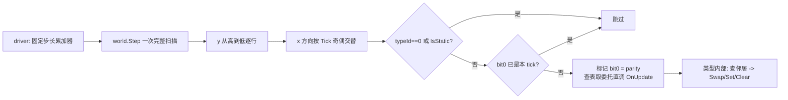

# 粒子系统接口规范

> 状态：v1 草案，待团队评审后冻结
> 适用：Unity 2022.3.62f1 / URP 14.0.12 (2D Renderer) / Mono2x / .NET Standard 2.0
> 位置：`docs/` 位于 `Assets/` 之外，Unity 不会导入，无需 `.meta`。
> 本文只规定「一个粒子类型类应该长什么样」，**不规定游戏里应该有哪些粒子类型**——类型清单由各人按需求新增，走第 11 节的流程。

---

## 1. 不可协商的设计约束

这些是架构前提，任何类型实现都不得绕开：

1. 所有粒子的数据存在**一个连续的扁平数组**里（`Cell[]`），靠 `(x, y)` 直接算出下标寻址；**没有任何 GameObject / MonoBehaviour / ScriptableObject 承载单个粒子**。
2. 单个粒子只存**原始数据**（类型标识 + 状态位 + 颜色抖动索引），不含行为逻辑、不含物理组件、不含引用类型字段。
3. 类型属性（标签、密度、调色板、最大横流格数、是否受重力、是否静态）存在**全局静态注册表**里，按 `typeId` O(1) 数组寻址。
4. 注册表在启动时**一次性**初始化：每类型实例化一个行为单例，把 `OnUpdate` / `OnSpawn` / `OnKill` 提取成**委托**（函数指针）存进注册表数组。
5. 运行时只做 `typeId → 委托` 的查表直调。**热路径禁止**：字符串匹配、`Dictionary` 查询、接口虚分派、反射、装箱、闭包、LINQ、任何堆分配。
6. 位置变化一律通过**交换两个下标的 Cell 数据**完成，模拟过程中不产生任何对象创建或销毁。
7. 粒子间交互由当前被处理的粒子**直接读写邻居格**实现，不走事件、不走消息、不走回调链。
8. 生成 / 抹除是模拟系统提供的**原子操作**：语句无条件执行，所有前置判断由调用方在调用前完成。

### 允许的例外（明确划界）

- 类型单例上的**私有实例字段做类型级暂存**是允许的（例如反应扩散的邻域缓冲）。理由：整个模拟单线程、每类型只有一个实例，不存在 per-cell 状态。
  **禁止**把 per-cell 状态放进单例字段——per-cell 状态只能放进 `Cell`。
- 类型级配置常量（密度、调色板）写在类里；**全局**模拟参数（网格尺寸、tick 频率、随机种子）走 `ScriptableObject`。
- `string DebugName` 允许存在，因为它只用于编辑器/日志显示，**永不出现在模拟热路径**。

---

## 2. 坐标、索引与边界

| 约定 | 定义 |
|---|---|
| 坐标 | `x ∈ [0, Width)`，`y ∈ [0, Height)`，整数格坐标 |
| 原点 | **(0, 0) 在左下角**；`y` 向上增大 |
| 重力方向 | **-y**（向下） |
| 下标 | `index = y * Width + x` |
| 扫描 | 行从 `y = Height-1` 到 `0`（从上到下）；同一行内 x 方向逐 tick 交替 |
| 越界读 | `GetCell` 返回**空气格**（`typeId == 0`），不抛异常 |
| 越界写 | `Set` / `Clear` / `Swap` 是**定义好的空操作**，返回 `false`，不做任何写入 |
| 空气 | `typeId == 0` 保留，永不注册行为，永不进入行为调用 |

`IsInBounds(x, y)` 存在且是首选判断方式。越界写是**静默空操作**：不抛异常、不刷日志（逐格日志会淹没控制台）。类型代码必须自己先判断，写操作内部的越界检查只是安全网。
唯一会报错的非法输入是「未注册的 `typeId`」：`Set` 会拒绝写入并 `Debug.LogError` 一次（每个世界实例至多一条）。

网格尺寸上限：单边 ≤ 4096（`Texture2D` 极限 16384，但 CPU `Color32` 缓冲与全量上传成本随面积线性增长）。

---

## 3. Cell 数据布局

**唯一真源：`Cell.cs`。** 其它任何文件不得复制该结构。

```csharp
// Assets/Scripts/Simulation/Cell.cs
[StructLayout(LayoutKind.Sequential)]
public struct Cell
{
    public ushort typeId;   // 0 = 空气；非 0 = 全局注册表下标
    public byte   flags;    // 见下表；bit0 由模拟系统独占管理
    public byte   shade;    // 调色板索引，生成时按该类型调色板随机抽样
}
```

- 尺寸 **4 字节**，无填充。
- `Array.Sort` 式的大数组访存因此是每格 4 字节；网格 1024×512 = 512K 格 = **2 MB** CPU 缓冲，同尺寸 `RGBA32` 纹理 = 2 MB。
- `typeId` 为 `ushort`：最多 65534 个类型（0 被空气占用；实现上限 `ParticleRegistry.MaxTypeCount = ushort.MaxValue - 1`）。
- `shade` 为 `byte`：调色板最多 256 色。

### flags 位分配（`CellFlags.cs` 集中定义，禁止散落魔法数字）

| 位 | 名称 | 归属 | 语义 |
|---|---|---|---|
| bit0 | `ProcessedParity` | **模拟系统独占** | 存「该格最后一次变动的 tick 奇偶」。`(flags & 1) != (Tick & 1)` 即本 tick 尚未被处理 |
| bit1 | `Burning` | 通用（类型无关） | 燃烧中 |
| bit2 | `Forced` | 通用（类型无关） | 受外部作用力 / 被推动 |
| bit3-7 | 类型私有 | 各类型自行定义 | 必须在**该类型文件头部注释**里登记占用位 |

规则：

- **bit0 使用奇偶存储，因此不需要每 tick 做 O(N) 清零 pass。** 类型代码**永远不要**直接写 `flags`，用 `world.At(x,y).flags |= CellFlags.Burning;`（OR 保留 bit0）这类写法；整体赋值 `flags = ...` 会破坏 bit0，属于违规。
- 类型私有位是安全的：一格在同一时刻只属于一个类型。
- 类型在 `OnUpdate` 里**不需要**检查 bit0 —— 模拟系统在派发前已经跳过本 tick 已处理的格。

### 关于 `vx` / `vy`（速度场，可选）

**v1 默认不包含**，`Cell` 固定 4 字节。理由：基础元胞自动机规则不需要速度场，而 4 字节布局的访存密度更好。

启用时机与代价：**后期可安全补上**。因为所有跨格移动都走 `Swap` / `Set`（整格拷贝），在 `Cell.cs` 追加

```csharp
    public sbyte vx;        // 变为 6 字节（对齐 2，无填充）
    public sbyte vy;
```

不会波及任何类型代码。推进到速度场模拟时改这一个文件即可（外加 `ParticleWorld` 的写入初始化）。

---

## 4. 全局类型注册表

```csharp
// Assets/Scripts/Simulation/ParticleTags.cs —— 类别标签（跨类型通用规则的唯一判据）
[Flags]
public enum ParticleTags : byte
{
    None   = 0,
    Solid  = 1 << 0,   // 固体：堆叠、有安息角
    Liquid = 1 << 1,   // 液体：自由横流
    Gas    = 1 << 2,   // 气体：可被置换，向上
}
```

```csharp
// Assets/Scripts/Simulation/ParticleTypeInfo.cs —— 作者侧结构（只在注册时读一次）
public readonly struct ParticleTypeInfo
{
    public readonly ParticleTags Tags;           // 类别标签，至少带一个（Solid / Liquid / Gas；None 会被注册校验拒绝）
    public readonly float    Density;            // 密度；内置规则不读，留给同类内再排序的类型自实现
    public readonly bool     AffectedByGravity;  // 是否受重力
    public readonly bool     IsStatic;           // 静态：扫描直接跳过，不进入 OnUpdate
    public readonly byte     MaxFlowSpread;      // 最大横流格数（单 tick 单侧横向最大蔓延）
    public readonly Color32[] Palette;           // 调色板，长度 1..256，索引 = Cell.shade
    public readonly string   DebugName;          // 仅调试显示，热路径禁用
}
```

### 标签（Tag）：跨类型规则的唯一判据

标签是「谁能让开谁」的唯一依据，**规则里永远不出现具体 typeId 的判断**——新增一种固体不需要改任何已有类型。

| 标签 | rank | 含义 |
|---|---|---|
| `Solid` | 3 | 固体：互相堆叠、有安息角，可沉穿液体/气体 |
| `Liquid` | 2 | 液体：可自由横流，可沉穿气体 |
| `Gas` | 1 | 气体：可被固/液置换，通常自行上升 |
| （空气） | 0 | `typeId == 0`，不属于任何类型 |

一个字节允许同时带多个标签（`[Flags]`）；`TagRank` 取其中最高的类别。

**置换规则**：`rank(自己) > rank(目标)` 才能换过去。于是——

- 固体只会被**同为固体**的粒子挡住：`TryFall` 撞到 Solid 就返回 false。
- 同类之间 `rank` 相等，互不置换 ⇒ 沙能堆、石头能垒。
- 固体落进液体/气体时 rank 更高 ⇒ 下沉穿过。

`ParticleRules` 提供 `TagRank(ParticleTags)` 与 `IsSolid(world, x, y)` 两个原语，类型代码直接调用；`CanDisplace` / `CanFlowThrough` 已内置上述规则，并额外拒绝静态格（`IsStatic`）目标。`CanDisplace` 对**越界目标一律返回 false**（否则越界会被当成「空气可进入」，调用方以为能移动、随后的 `Swap` 却静默失败）；同时仍会拒绝静态格目标。

```csharp
// Assets/Scripts/Simulation/ParticleType.cs —— 注册表条目（不可变）
public sealed class ParticleType
{
    public readonly ushort Id;
    public readonly ParticleTypeInfo Info;
    public readonly ParticleUpdateDelegate OnUpdate;   // 提取自单例实例
    public readonly ParticleSpawnDelegate  OnSpawn;
    public readonly ParticleKillDelegate   OnKill;
}

public delegate void ParticleUpdateDelegate(ParticleWorld world, int x, int y);
public delegate void ParticleSpawnDelegate (ParticleWorld world, int x, int y);
public delegate void ParticleKillDelegate  (ParticleWorld world, int x, int y, ushort killerTypeId);
```

```csharp
// Assets/Scripts/Simulation/ParticleRegistry.cs
public static class ParticleRegistry
{
    public const ushort AirTypeId = 0;
    public static int Count { get; }
    public static ParticleType[] Types { get; }    // Types[typeId] 直取，无字典
    public static ushort Register(IParticleType behaviour);             // 单个：校验失败不留任何状态
    public static ushort[] RegisterBatch(params IParticleType[] items); // 批量：先全部校验再统一写入，原子
    public static void ValidateTypeInfo(ParticleTypeInfo info, string description);   // 自定义类型表复用同一套校验
}
```

要点：

- **`typeId` = 注册顺序**，从 1 开始，0 保留给空气。`ParticleRegistration.RegisterAll()` 是**全工程唯一的类型清单**。
- 用 `ParticleType[]`（引用类型数组）而不是结构体数组：`Types[id].Info.Density` 只做指针寻址，不会每帧拷贝几十字节的结构体。
- 注册时校验（`ValidateTypeInfo`）：调色板非空且 ≤256、`Density` 有限、**至少带一个类别标签（`Tags != None`）**、类型数未溢出。违反 = **抛 `InvalidOperationException`**，且校验发生在写入任何状态之前。
- `ParticleRegistration` 用 `RegisterBatch` 一次性注册：**先全部校验、再统一写入**，任一类型非法则整体不生效，`ParticleIds` 只会在全部成功后才回填——这样就不会出现「前几个类型已注册、后面的 `ParticleIds.Xxx` 仍是 0（空气）」的静默退化。失败后 `RegisterAll()` 的后续调用会继续抛出，不会当作成功。
- **自定义类型表也要过同一套校验**：`new ParticleWorld(w, h, seed, types)` 会对每个非 null 条目调用 `ValidateTypeInfo`，非法条目直接抛 `ArgumentException`，而不是等到运行期 `Set` 才 DivideByZero。
- `Types[0]` 恒为 `null`（空气）；数组容量可能大于 `Count + 1`，超出部分是 `null`。`ParticleWorld` 与渲染层对超出范围的 id 一律当作「不存在的类型」跳过。
- 注册完成后再不修改。单线程读，无需锁。
- 初始化入口固定在启动点，且域重载安全：

```csharp
[RuntimeInitializeOnLoadMethod(RuntimeInitializeLoadType.BeforeSceneLoad)]
static void Bootstrap() => RegisterAll();
```

- **禁止**在热路径写裸数字 `typeId`。跨类型引用（A 生成 B）统一用 `ParticleIds` 静态字段，由注册流程回填：

```csharp
// Assets/Scripts/Simulation/ParticleIds.cs
public static class ParticleIds
{
    public const ushort Air = ParticleRegistry.AirTypeId;
    public static ushort Stone;     // 由 ParticleRegistration.RegisterAll() 依序回填
    public static ushort Sand;
    // 每新增一个类型，这里加一个字段
}
```

- 注册顺序 = 存档兼容性的一部分。**一旦有存档/回放，禁止重排已有顺序**，只能追加。

---

## 5. 粒子类契约

### 目录与命名

- 一个类型 = **一个文件**，放在 `Assets/Scripts/Simulation/Particles/`。
- 文件名 = 类名，`PascalCase`，后缀 `Particle`：`XxxParticle.cs`。
- 类型需要附带资源（多个源文件、调试工具）时，可以为它建子目录 `Particles/Xxx/`，但**入口行为类仍然每类型一个文件**。
- 类必须是 `public sealed class`，**继承任何基类都不允许**、**不是 MonoBehaviour**、**不是 ScriptableObject**。

### 编译期契约

```csharp
public interface IParticleType
{
    ParticleTypeInfo Info { get; }
    void OnUpdate(ParticleWorld world, int x, int y);
    void OnSpawn (ParticleWorld world, int x, int y);
    void OnKill  (ParticleWorld world, int x, int y, ushort killerTypeId);
}
```

**接口只用于作者期约束和注册期取委托。** 运行期持有的是注册表里的 `ParticleType`（委托 + 数据），**从不持有 `IParticleType` 引用、从不通过接口调方法**——这保证热路径没有接口虚分派。

### 三个钩子的精确职责

| 钩子 | 何时被调用 | 应该做什么 | 不应该做什么 |
|---|---|---|---|
| `OnUpdate` | 扫描到该类型且该格本 tick 未被处理时，**每 tick 至多一次** | 查邻居 → 判断 → 调用 `Swap`/`Set`/`Clear` 实现下落、流动、扩散、反应 | 不做渲染、不读 `Time.*`、不分配 |
| `OnSpawn` | **每次**通过 `Set` 创建该类型格之后（`Swap` 不会触发） | 额外初始化：`vx/vy`、类型私有 flag 位、需要特定 `shade` 时覆盖默认抽样 | 不把新格再挪走（它已标记为本 tick 已处理） |
| `OnKill` | 该类型格被**其它类型或空气覆盖**时，在写入新格**之前**调用 | 残留效果（往**邻居**格写烟/火/灰）、清理由自己申请的全局资源 | **写自己脚下那一格**（会被随后写入的新格覆盖，见下） |

`OnKill` 的 `killerTypeId == 0` 表示被抹除（`Clear`），非 0 表示被该类型覆盖。

`OnUpdate` / `OnSpawn` 的 `(x, y)` 是调用时刻该粒子的坐标，**就是 `world.Index` 反算的坐标**，不需要类型自己做除法。

### 单例实例上的字段

允许且推荐：类型级只读配置、调色板、邻域暂存缓冲。

```csharp
public sealed class XxxParticle : IParticleType
{
    private static readonly Color32[] Palette = { /* 1..256 个颜色 */ };
    private readonly Color32[] _neighbourScratch = new Color32[9];   // 允许：类型级暂存

    public ParticleTypeInfo Info => new ParticleTypeInfo(
        tags: ParticleTags.Solid,
        density: 1.0f,
        affectedByGravity: true,
        isStatic: false,
        maxFlowSpread: 0,
        palette: Palette,
        debugName: nameof(XxxParticle));

    public void OnUpdate(ParticleWorld world, int x, int y) { /* ... */ }
    public void OnSpawn (ParticleWorld world, int x, int y) { }
    public void OnKill  (ParticleWorld world, int x, int y, ushort killerTypeId) { }
}
```

`Info` 只在注册时被读一次；每次访问新建一个结构体是刻意的（不走热路径）。

---

## 6. 世界 API（类型作者能用的全部原语）

```csharp
// Assets/Scripts/Simulation/ParticleWorld.cs —— 纯 C# 类，不是 MonoBehaviour
public sealed class ParticleWorld
{
    public ParticleWorld(int width, int height, uint seed);                       // 使用全局注册表 Types
    public ParticleWorld(int width, int height, uint seed, ParticleType[] types); // 隔离测试用自定义类型表

    public int  Width  { get; }
    public int  Height { get; }
    public int  CellCount { get; }              // == Width * Height
    public int  Tick   { get; }                 // 已完成的 tick 计数
    public bool Parity => (Tick & 1) != 0;      // 本次 Step 的扫描方向奇偶
    public Cell[] Cells { get; }                // 底层数组，只读契约：外部只允许读
    public ParticleType[] Types { get; }        // Types[0] == null（空气）

    // —— 读 ——
    public int  Index(int x, int y);            // y * Width + x
    public bool IsInBounds(int x, int y);
    public bool IsAir(int x, int y);
    public Cell GetCell(int x, int y);          // 值拷贝（4 字节）；越界返回空气
    public ref Cell At(int x, int y);           // 本格就地读写（flags/shade/vx/vy）；越界返回只读暂存格

    // —— 写（原子、无条件执行、返回是否落到网格内）——
    public bool Swap (int x0, int y0, int x1, int y1);
    public bool Set  (int x, int y, ushort typeId);
    public bool Clear(int x, int y);            // 等价于 Set(x, y, 0)

    // —— 确定性随机（世界持有种子）——
    public uint NextUInt();
    public int  NextInt (int  maxExclusive);    // maxExclusive <= 0 → 0
    public byte NextByte(byte maxExclusive);    // 用于 shade 抽样

    public void Step();                         // 驱动一次完整扫描（由 driver 调用）
}
```

> 种子约定：`seed == 0` 会被静默替换为内部默认种子（xorshift32 需要非零状态）。回放/存档请避免使用 0。


### 写操作的钩子与副作用（精确定义）

| 调用 | 目标格原为 | `OnKill` | 新格 `shade` | `OnSpawn` |
|---|---|---|---|---|
| `Set(x,y,T)` | 空气 | — | 按 T 的调色板**重新抽样** | T |
| `Set(x,y,T)` | 类型 U（U ≠ T） | `U.OnKill(x,y,T)` | 重新抽样 | T |
| `Set(x,y,T)` | 类型 T | 不触发，整格保持不变 | 不变 | 不触发 |
| `Clear(x,y)` | 类型 U（U ≠ 0） | `U.OnKill(x,y,0)` | — | — |
| `Clear(x,y)` | 空气 | — | — | — |
| `Swap(A,B)` | 任意 | **不触发** | **随 Cell 一起移动，不重新抽样** | 不触发 |

`Set` 的执行顺序（实现必须严格照此）：

1. 读受害者 `typeId`；
2. 若受害者非空气且 ≠ 新类型 → 调 `victim.OnKill(world, x, y, newTypeId)`。此刻网格上该格**仍是受害者本体**；
3. 写入新 `Cell`（`typeId = T`、`flags = 当前 parity`、`shade = 抽样`）；
4. 调 `T.OnSpawn(world, x, y)`。

因此 **`OnKill` 内对本格的写会被第 3 步覆盖**——残留物必须写到邻居格。

### 三条硬规则

1. **世界不做合法性判断。** `Swap` 不会阻止你把石头换走，`Set` 不会阻止你覆盖静态格。是否允许替换（比标签、查 `IsStatic`）由类型逻辑自己决定，这正是 `ParticleRegistry.Types[...]` 暴露在外面的原因。注意：共享原语 `ParticleRules.CanDisplace` / `CanFlowThrough` 为方便起见**内置**了静态格拒绝——它们服务常见情况；确实需要置换静态格的类型可以用裸 `Swap` 自行实现。
2. **前置判断在调用前完成。** 先用 `IsInBounds` / `IsAir` / `GetCell` 判断，再无条件调用写操作。写操作内部的越界检查只是安全网。
3. **移动之后立刻返回。** 任何会改变自身坐标的写操作（`Swap` / 覆盖自身的 `Set`）之后，`(x, y)` 与 `world.At(x,y)` 立刻失效。同一次 `OnUpdate` 内禁止继续基于旧坐标操作。一个 `OnUpdate` 只做一次决策 + 至多一次移动。

`Swap` 会把两个格的 bit0 都写成当前 parity，所以：

- 被换到已扫描位置的粒子本 tick 不再被处理（符合「每格每 tick 至多一次」）；
- 被换到尚未扫描位置的粒子也不会被二次处理（扫描循环先查 bit0）。

这条 bookkeeping 由世界负责，类型代码不能、也不需要手动维护。

### 步进之外写入网格

`Set` / `Clear` / `Swap` 在两次 `Step()` 之间被调用时（例如鼠标绘制、关卡加载），bit0 会被写成**「下一次 Step 的奇偶取反」**，也就是「未处理」。因此外部新建的粒子必定会在下一个 tick 被处理，不会因为标记而白等一帧。同样由世界负责，类型代码无需关心。

---

## 7. 主循环语义



- **固定时间步长**，与渲染帧率解耦：`ParticleSimulationDriver`（MonoBehaviour）用累加器，每帧最多跑 `MaxStepsPerFrame` 次 `Step()`，防止死亡螺旋。
- 扫描顺序：**行永远从上到下**；**水平方向逐 tick 交替**（偶 tick x 升序、奇 tick x 降序）以消除重力/流动的方向偏置。交替由扫描循环内部完成，类型代码不感知。
- 空气格与 `IsStatic` 类型**直接跳过**，不进行为调用（静态类型仍会收到 `OnSpawn` / `OnKill`）。
- 扫描循环在**访问那一刻**从扁平数组读 `typeId` 再取委托，不做跨 tick 缓存。
- 单线程，主线程。不存在并行扫描。
- `Step` 用 `try/finally` 恢复写入标记：某个 `OnUpdate` 抛异常时 `_tick` 不自增、`_stamp` 按「旧 tick」恢复，因此异常后新建的粒子仍会在下一次 `Step` 被处理，不会白等一 tick。

---

## 8. 写 `OnUpdate` 的推荐形态

```csharp
public void OnUpdate(ParticleWorld world, int x, int y)
{
    // 1) 读自己的数据（需要时缓存 ParticleType 到局部变量）
    ParticleType self = ParticleRegistry.Types[world.At(x, y).typeId];

    // 2) 先查后动：所有判断都在这里完成
    int ny = y - 1;
    if (!world.IsInBounds(x, ny)) return;            // 越界 = 空气，是否允许流出网格由类型自己定
    if (world.IsAir(x, ny)) { world.Swap(x, y, x, ny); return; }   // 3) 无条件执行 + 立即返回

    // 4) 与邻居的类型交互：通用规则只看标签，不看具体类型
    ushort otherId = world.GetCell(x, ny).typeId;
    if (otherId == ParticleRegistry.AirTypeId) return;
    ParticleType other = ParticleRegistry.Types[otherId];
    if (other.Info.IsStatic) return;
    if (ParticleRules.TagRank(other.Info.Tags) >= ParticleRules.TagRank(self.Info.Tags)) return;

    world.Swap(x, y, x, ny);
}
```

约定：

- 随机一律用 `world.NextUInt/NextInt/NextByte`，**禁止 `UnityEngine.Random`**（会破坏确定性与可复现回放）。
- 禁止 `Time.deltaTime` / `Time.time`：时间语义只有 `world.Tick`。
- 禁止在 `Update`/`OnUpdate` 里 `new`、装箱、捕获局部变量的 lambda、LINQ、字符串拼接。
- 重复的移动规则（下落、斜落、横流）应抽成**静态无状态帮助方法**（例如 `ParticleRules.*`），而不是继承基类；帮助方法同样只在参数里传 `world`/坐标，不持有每格状态。
- 标签、最大横流格数等属性从 `ParticleRegistry.Types[id].Info` 读；**这些值在运行期不可变**，任何类型都不得修改注册表条目。
- **跨类型判断一律走标签**（`ParticleRules.TagRank` / `IsSolid`），不要写 `if (other.Info.DebugName == "Stone")` 这类特判——那会毁掉「新增类型零改动」的性质。

---

## 9. 渲染契约

### 与模拟帧解耦（重点）

**上屏时机是一条明确的接缝，不写在模拟里。** 分层如下：

| 层 | 职责 | 不知道什么 |
|---|---|---|
| `ParticleWorld.Step()` | 只推进模拟、只改 `Cell[]` | **完全不知道渲染存在**（`Simulation` 程序集不引用任何渲染对象） |
| `ParticlePixelBuffer.Fill()` | `Cell[]` → `Color32[]` 的纯数据映射 | 不知道纹理、材质、相机 |
| `ParticleRenderer.Present()` | 把已有缓冲 `SetPixels32` + `Apply` 上传一次 | 不知道跑了几步、谁是 tick |
| `ParticleSimulationDriver` | 固定步长推进 + **唯一决定上屏时机的地方** | —— |

驱动侧的循环：

```csharp
_world.Step();
_stepsSincePresent++;
if (_stepsSincePresent >= settings.StepsPerPresent) Present();   // 默认 StepsPerPresent = 1
```

- **默认 `StepsPerPresent = 1`：每个逻辑帧后调用一次渲染。**
- 调大即可变成「多个逻辑帧渲染一次」（例如 4 = 4 个逻辑帧只上传一次），**不需要改动模拟或渲染任何代码**。
- 反过来拖慢 tick 频率、或某一帧累加器没攒够一步（`steps == 0`）时，本帧不做任何上传——画面停留在上一次的结果。
- `ParticleRenderer` 是可选引用；未指定时驱动照常跑模拟，只是不上屏。

> 注意这是**上屏时机**，不是**模拟正确性**：`Step()` 之间没有隐式上屏，多步之间也不会有中间态泄漏到屏幕。

### 渲染实现

- **不创建任何 per-particle 的 GameObject / SpriteRenderer / Transform。** 整个网格只有 1 个渲染对象。
- 像素缓冲 `Color32[] _pixels`，长度 = `world.CellCount`，填充逻辑集中在 `ParticlePixelBuffer.Fill(world, pixels, background)`：
  - `pixels[i] = world.Types[cells[i].typeId].Info.Palette[cells[i].shade]`
  - 空气、未注册 id、`null` 槽位一律写背景色；`shade` 越界时回退 `palette[0]`。
  - 这个方法是纯函数、无引擎依赖，因此**可以在 EditMode 测试里直接断言**，不需要 GPU。
- 目标对象：**1 个 quad**。运行时用代码建一个 4 顶点 mesh（不是 `GameObject.CreatePrimitive`，避免附带 Collider），挂在子物体上，顶点范围就是 `(0,0)`–`(Width, Height)` 世界单位，1 cell = 1 unit。
- 材质：优先 `Universal Render Pipeline/2D/Sprite-Unlit-Default`，回退 `Sprites/Default`；都找不到时报错并**停止上屏**（不再每帧刷日志）。可在 Inspector 覆盖。**发布包要注意 shader 剥离**，届时把该 shader 加入 Always Included Shaders 或直接指定材质资产。
  - Inspector 指定的 `_material` 是共享资产：运行期一律 `new Material(_material)` 取副本，**绝不改写资产本身**；销毁/重建纹理前先把 `mainTexture` 置 null，避免材质持有 Missing 引用。
  - 「渲染目标就绪」= 纹理尺寸匹配 **且** mesh 与材质都已挂上。shader 缺失导致首次失败后不会每帧重试；一旦补上 `_material`，下一次 `Present` 会自动重建并恢复上屏。
- 纹理：`new Texture2D(Width, Height, TextureFormat.RGBA32, mipChain: false, linear: false)`，`filterMode = FilterMode.Point`（必须），`wrapMode = TextureWrapMode.Clamp`，`hideFlags = DontSave`。
- 上传：一次 `SetPixels32` + `Apply(false, false)`。世界尺寸变化时才重建纹理与 mesh。
- 相机：`orthographicSize = Height / 2`，位置 `(Width / 2, Height / 2, -10)`（可关）。相机移动**不触碰 `Cell[]`、不重建纹理**。
- 后续优化（不改数据结构）：只对相机可见矩形调用带 `Rect` 的 `SetPixels32` 重载 + `Apply`，CPU 侧仍是同一块全尺寸缓冲。

---

## 10. 文件清单（已落地）

```
Assets/Scripts/
  TapTap2026.Game.asmdef                      ← 渲染层 + 驱动层
  Simulation/
    TapTap2026.Simulation.asmdef              ← 纯模拟，无渲染引用
    Cell.cs                                   Cell 结构体（唯一真源）
    CellFlags.cs                              flag 位常量 + 读写帮助
    IParticleType.cs                          IParticleType + 三个委托类型
    ParticleTags.cs                           类别标签 Solid / Liquid / Gas
    ParticleTypeInfo.cs                       类型属性结构体
    ParticleType.cs                           注册表条目（Id + Info + 三委托）
    ParticleRegistry.cs                       全局静态注册表 + Register 校验
    ParticleIds.cs                            类型 id 静态字段（注册时回填）
    ParticleRegistration.cs                   唯一类型清单（新增类型只改这里）
    ParticleWorld.cs                          扁平数组、扫描、读写原语、RNG
    ParticleRules.cs                          无状态共享移动规则
    ParticlePixelBuffer.cs                    Cell[] → Color32[] 的纯映射
    Particles/
      StoneParticle.cs                        石头（固体标签，斜落要 10 格净空 ⇒ 10:1 安息角，~84° 的陡尖堆）
      SandParticle.cs                         沙（固体标签，1:1 安息角三角堆）
      SoilParticle.cs                         土壤（固体标签，2:1 安息角三角堆，边坡比沙陡一倍）
  Rendering/
    ParticleRenderer.cs                       Color32 缓冲 + Texture2D + quad
  Driver/
    ParticleSimulationSettings.cs             全局模拟参数（ScriptableObject）
    ParticleSimulationDriver.cs               MonoBehaviour：固定步长驱动 + 上屏调度
    ParticleSandboxSeeder.cs                  演示用（默认不跑）：右键菜单 Reseed() 才铺石头容器 + 中央一堆沙
    ParticleEditor.cs                         调试用：左键刷当前粒子、右键切换类型、鼠标旁显示当前类型
  Editor/
    TapTap2026.Editor.asmdef                  ← 仅 Editor 平台的工具程序集
    SystemProxyGuard.cs                       系统代理无法被 Mono 解析时把 WebRequest.DefaultWebProxy 钉为直连（保 Unity-MCP 连通）
Assets/Data/
  ParticleSimulationSettings.asset            实例化后的全局参数资产（320x180 / 60Hz / seed 123456789）
Assets/Tests/EditMode/
  TapTap2026.Tests.EditMode.asmdef
  TestParticleFixtures.cs                     测试专用粒子类型
  ParticleWorldTests.cs                       世界/钩子/确定性/像素映射 + 斜落净空判据/石头堆 10:1 坡/固体互阻/沙堆守恒收敛/土堆斜率两倍于沙（隔离类型表）
  SandStoneParticleTests.cs                   石头/沙子/土壤的生产注册路径（RegisterAll 回填 + 标签断言）+ 安息角剖面（三角堆）测试
```

程序集划分：`TapTap2026.Simulation`（无渲染依赖，`Particles/` 归入同一程序集，新增类型不需要动 asmdef）、`TapTap2026.Game`（引用 Simulation，装渲染与驱动）与 `TapTap2026.Editor`（仅 Editor 平台，无运行时引用，编辑器工具）。

**场景接线（已完成，`SampleScene.unity`）**：场景根下 `Particle Sandbox` 一个物体，挂四个组件并已两两接线：

```
Particle Sandbox
├─ ParticleRenderer            (无外部引用，材质运行期自建；_fitCameraOnInitialize=1)
├─ ParticleSimulationDriver    _renderer → 上面的 ParticleRenderer
│                              _settings → Assets/Data/ParticleSimulationSettings.asset
├─ ParticleSandboxSeeder       _driver   → 上面的 ParticleSimulationDriver
│                              （默认什么都不做；地板厚 3、挡墙厚 3、沙 50%x60% 仅在显式 Reseed 时使用）
└─ ParticleEditor              _driver   → 上面的 ParticleSimulationDriver
                               _renderer → 上面的 ParticleRenderer（屏幕→格子的换算基准）
                               _drawHud=1
```

- **沙箱初始是空世界**：`ParticleSimulationDriver.Awake` 建出的网格全是空气，没有任何粒子；`ParticleSandboxSeeder` 不再在 `Start` 自动搭建，内容只能由 `ParticleEditor` 画出来。
- **编辑操作（`ParticleEditor`）**：按住**左键**用当前粒子填满鼠标处半径 3 的实心圆（29 格）；按**右键**在已注册类型间循环切换；鼠标旁常驻色块 + 类型名 + `序号/总数`。写入走 `world.Set`，因此世界会把新格标成「本 tick 未处理」，画的粒子下一 tick 必定被模拟；驱动暂停（`Simulate = false`）时编辑器补一次 `PresentNow()` 以便看到刚落下的东西。鼠标 → 格子：相机射线打到 z=0 平面后换算到渲染器局部坐标取整，网格 quad 的 1 cell = 1 unit 是这条换算成立的前提。
- **预设演示内容已弃用**：`ParticleSandboxSeeder` 的「石头容器 + 沙堆」预设在石头改为斜落（10 格净空）后不再稳定——整列挡墙内缘高处的石块会滑入容器。保留仅为兼容旧场景；新内容用 `ParticleEditor` 手绘。（右键菜单 `Reseed()` 仍可用，但别指望挡墙长期不漏。）
- 相机由渲染器在首次建立纹理时自动摆正（`orthographicSize = Height/2`，位置 `(Width/2, Height/2, -10)`），Main Camera 本身无需手改。

---

## 11. 新增一个粒子类型的流程

1. 在 `Assets/Scripts/Simulation/Particles/` 新建 `XxxParticle.cs`，`public sealed class XxxParticle : IParticleType`，实现 `Info` / `OnUpdate` / `OnSpawn` / `OnKill`。
2. 在文件头注释里登记：占用的 flags 私有位、需要的邻居查询范围、与哪些 `ParticleIds` 交互。
3. 在 `ParticleRegistration.RegisterAll()` 里追加一行 `ParticleIds.Xxx = ParticleRegistry.Register(new XxxParticle());`（**只能追加，不能插队重排**）。
4. 在 `ParticleIds` 里加对应 `public static ushort Xxx;` 字段。
5. 自测：EditMode 测试里 `new ParticleWorld(w, h, seed)`，手动 `Set` 若干格，跑 N 次 `Step()`，断言最终 `GetCell` 分布（不依赖渲染、不依赖场景）。

评审清单：

- [ ] 一个类型一个文件；`sealed`；无基类；非 MonoBehaviour。
- [ ] `OnUpdate` 内无分配、无 LINQ、无字符串、无 `UnityEngine.Random`、无 `Time.*`。
- [ ] 每个写操作之前都有显式判断；写操作之后**立即 return**。
- [ ] 没有直接写 `Cell.typeId`（绕过钩子）；没有整体覆盖 `flags`（破坏 bit0）。
- [ ] 没有把 per-cell 状态放进单例字段。
- [ ] 越界坐标先经 `IsInBounds` 判断，而不是依赖写操作静默失败。
- [ ] 调色板 1..256 项，`shade` 语义一致。
- [ ] 静态类型的 `OnUpdate` 不会被调用——留空并注明原因，不要往里写逻辑。

---

## 12. 明确禁止

| 禁止 | 原因 |
|---|---|
| 用 GameObject / MonoBehaviour / SpriteRenderer 承载单个粒子 | 破坏扁平数组与 O(1) 寻址，GC 与 transform 开销不可接受 |
| 在热路径用 `Dictionary` / 字符串 / 反射 / `GetType()` | 设计硬约束：只允许 `typeId` 数组寻址 + 委托直调 |
| `Cell` 内放引用类型字段 | 破坏连续性、增加 GC 扫描面 |
| 让类型继承基类或通过 `IParticleType` 引用调用方法 | 引入虚分派；接口只用于注册期取委托 |
| 在类型单例里存 per-cell 状态 | 逻辑上就把 per-cell 数据挪出了扁平数组 |
| 运行期修改 `ParticleTypeInfo` / 重排注册顺序 | 破坏确定性与存档兼容性 |
| 在模拟代码里读 `Time.*`、`UnityEngine.Random`、`Input` | 破坏「固定步长 + 可复现」 |
| 直接改 `Color32` 缓冲 / 纹理来表示粒子状态 | 渲染缓冲是只读派生物，唯一真源是 `Cell[]` |

---

## 13. 待定决策（评审时拍板）

1. **`vx` / `vy`**：v1 采用 4 字节 `Cell`（不含速度）；确认何时切到 6 字节。
2. **tick 频率默认值**：现为 60 Hz、`MaxStepsPerFrame = 4`（放在 `ParticleSimulationSettings` 里，可改）。
3. **上屏倍数**：`StepsPerPresent` 现为 1（每个逻辑帧渲染一次）。等 tick 频率提高或网格变大后，评估是否调大以省掉同一帧内的重复上传。
4. **`ParticleRules` 共享帮助方法的边界**：已提供 `TryFall` / `TryDiagonalFall`（可选 `clearance`：斜下方落点起需要连续能进入的格数，1 = 1:1、2 = 2:1、10 = 10:1，越大越陡）/ `TryFlowHorizontal` / `CanDisplace`。当前 `SandParticle` 用 `clearance = 1`、`SoilParticle` 用 2、`StoneParticle` 用 10（三者的安息角都完全由斜落产生，没有横向铺展扫描）；`TryFlowHorizontal` 的「同 rank 穿行」已限制为**仅流体**（Liquid / Gas），固体不会横穿同类固体。确认还有哪些特化规则值得提升为共享原语。
5. **一键搭沙箱**：`SampleScene` 已接线完成；重建演示内容靠 `ParticleSandboxSeeder` 的 Inspector 右键菜单（`Reseed()`）。是否值得再加一个编辑器菜单项（`GameObject/粒子沙箱`）供新场景快速起一个。
6. **存档格式**：`Cell[]` 直接按 4 字节/格序列化 + 版本号，还是 RLE。v1 不做存档，但 id 顺序策略按「不可重排」执行。
